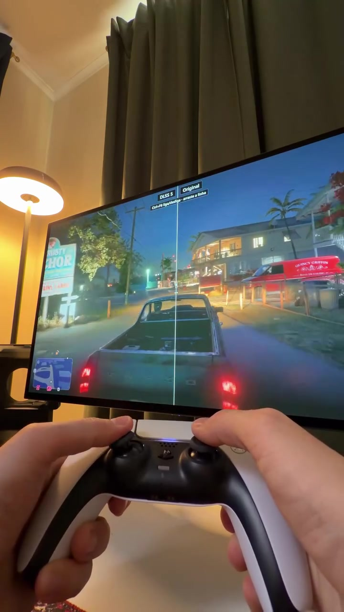
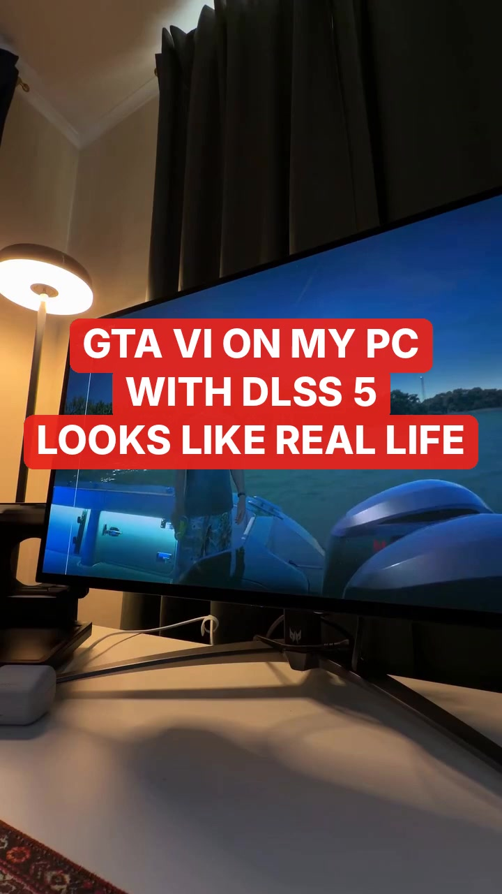
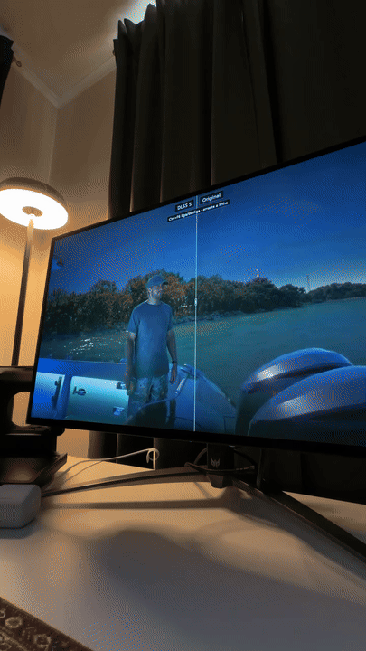
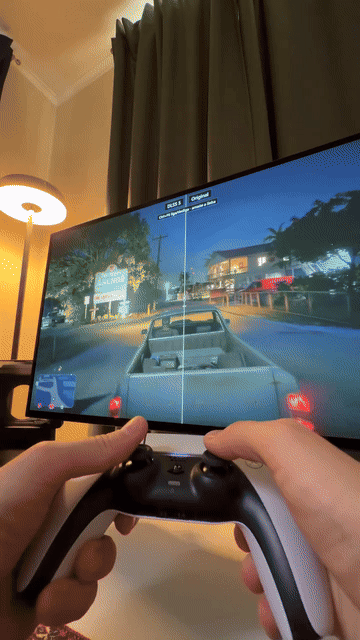
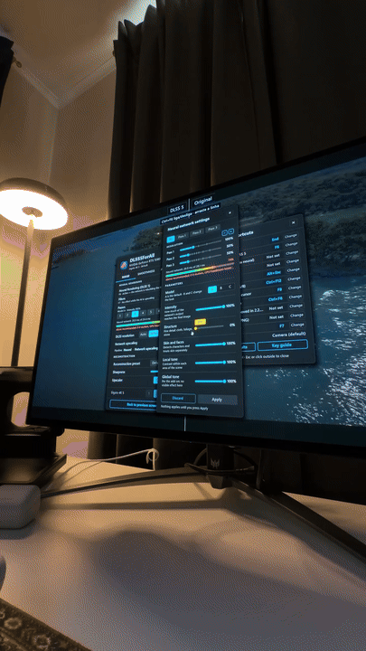
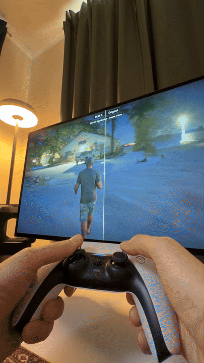
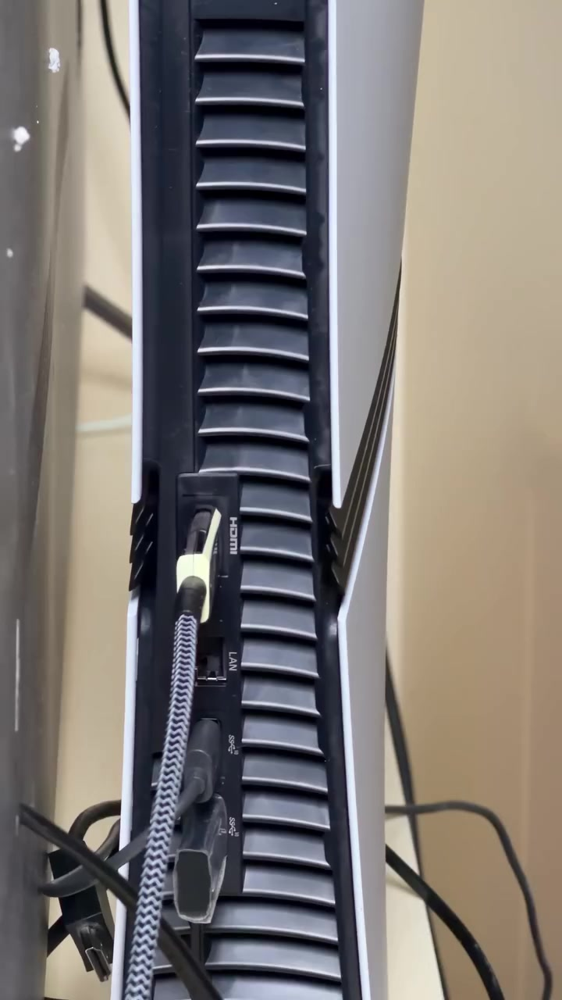
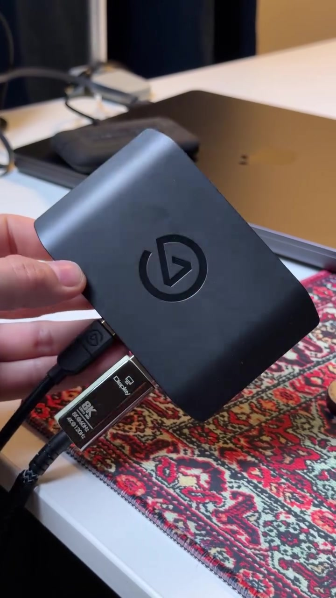
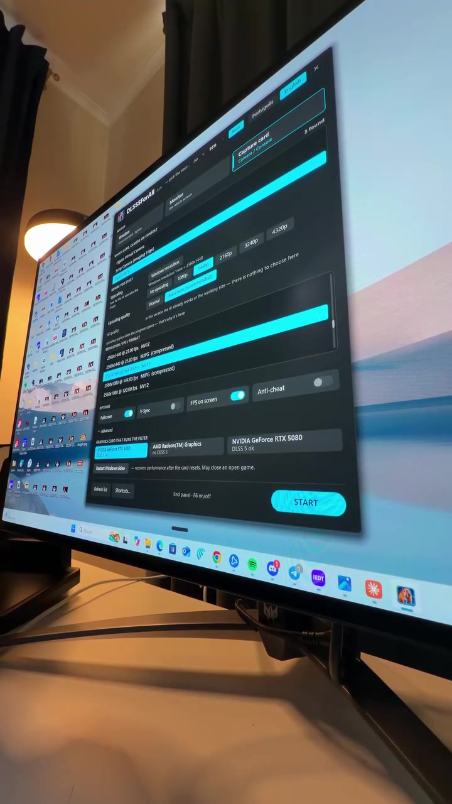
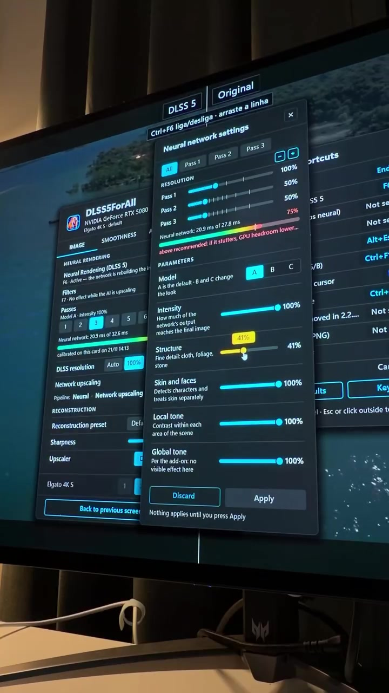

<div align="center">

# GTA VI on PC · DLSS 5 via capture card

**PS5 / PS5 Pro → Elgato 4K S → your PC → real-time neural rendering**

Creator: [X · @f0rgent](https://x.com/f0rgent) · Hub: [f0rgent.github.io](https://f0rgent.github.io)

No Claude yet? [Get Claude here](https://f0rgent.github.io/claude).



`Capture card` · `Neural Rendering` · `Frame smoothing` · `Live tuning` · `Side-by-side comparison`

Windows 11 · NVIDIA RTX · Elgato 4K S

### [⬇ Download DLSS 5 For All (free, official release)](https://github.com/pcdofafa/dlss5-for-all/releases/latest)

The app that does the neural rendering · by PC do Fafa · [source code](https://github.com/pcdofafa/dlss5-for-all) · [site](https://pcdofafa.com.br/dlss)

</div>

---

## What this is

GTA VI runs on the console. The PC never touches the game: it grabs the HDMI picture from a capture card and runs it through **DLSS5 For All**, a free app that applies DLSS 5 Neural Rendering to any video source in real time.

You get a sharper, more realistic picture, 60 FPS (120 if your GPU keeps up), and every setting live while you play.

This repo is our setup guide, tested settings and clips. The app itself belongs to its author: [pcdofafa/dlss5-for-all](https://github.com/pcdofafa/dlss5-for-all).

## Full video

[](media/gta6-pc-full-video.mp4)

**[▶ Watch the full 51-second video](media/gta6-pc-full-video.mp4)**: gameplay, side-by-side, wiring, app and settings.

## Results

| Left: DLSS 5 · Right: PS5 original | Driving at 60 FPS |
|---|---|
|  |  |

| Live neural settings | Character detail |
|---|---|
|  |  |

Full-quality clips: [dlss5-vs-original.mp4](media/dlss5-vs-original.mp4) · [drive-60fps.mp4](media/drive-60fps.mp4) · [neural-settings.mp4](media/neural-settings.mp4) · [character-detail.mp4](media/character-detail.mp4)

## The app: DLSS 5 For All

**DLSS 5 For All** is a free, open-source Windows app (C++, Direct3D 11) by PC do Fafa. It opens any video source (capture card, webcam, a window or a whole monitor) and runs it through DLSS 5 Neural Rendering in real time. Nothing is injected into the game, so it works with a console feed.

What it gives you:
- **Neural Rendering** with 1-10 passes, models A/B/C, intensity, structure, skin & faces, local/global tone
- **Smoothness** up to your monitor's refresh, plus frame skipping to save GPU
- **Comparison mode**: left half DLSS 5, right half original, same frame
- **Live panel** (`End`), instant on/off (`F6`), HDR capture, works on RTX 20-50 (AMD experimental)

Get it only from the official links above. We don't mirror the app: its license allows unmodified copies with credit only, and the official release is always the newest and safest version.

## What you need

| Part | Ours |
|---|---|
| Console | PS5 Pro (PS5 works too) |
| Capture card | Elgato 4K S (any UVC / Media Foundation card works) |
| GPU | NVIDIA RTX 5080 (RTX 20-50 supported; AMD is experimental) |
| OS | Windows 10 1903+ / Windows 11 64-bit |
| App | [DLSS5 For All](https://github.com/pcdofafa/dlss5-for-all) (free) |

## Setup (about 15 minutes)

| Step 1 · PS5 HDMI | Step 2 · Elgato 4K S | Step 3 · The app |
|---|---|---|
|  |  |  |

**1. Turn off HDCP on the PS5**
Settings → System → HDMI → **Enable HDCP: Off**. With it on, the capture card shows a black screen.

**2. Wire it**
PS5 HDMI out → Elgato 4K S **HDMI IN** → Elgato USB-C → a USB 3 port on the PC. Optional: Elgato **HDMI OUT** → your TV for a zero-lag passthrough.

**3. Install the app**
Download DLSS5 For All only from its [official repo](https://github.com/pcdofafa/dlss5-for-all). Unpack into a folder without accents and outside Program Files (e.g. `C:\DLSS5ForAll\`). Run `setup-dlss5.ps1` with PowerShell and follow the app's own README for the remaining runtime files.

**4. Pick the source**
Open `DLSS5ForAll.exe` → source **Capture card / camera** → **Elgato 4K S** → the highest mode it offers (1080p60 or 4K60). Close OBS, Camera and anything else holding the card. Or from the command line:

```
DLSS5ForAll.exe --list
DLSS5ForAll.exe --device 0 --mode 3 --fullscreen
```

**5. Turn it on**
`End` opens the panel. `F6` toggles DLSS 5 on/off (before/after). `Alt+Esc` twice quits.

**6. Record the before/after**
Panel → More options → **Comparison mode**. Left half is DLSS 5, right half is the original, same frame. Record with OBS → Window Capture → `DLSS5ForAll.exe`.

## Our settings (RTX 5080, Elgato 4K S)



| Setting | Value |
|---|---|
| Passes | 3 |
| Pass resolution | Pass 1: 50% · Pass 2: 50% · Pass 3: 75% |
| Model | A |
| Intensity | 100% |
| Structure | 41% |
| Skin and faces | 100% |
| Local tone | 100% |
| Global tone | 100% (no visible effect in this build) |
| DLSS resolution | 100% |
| Pipeline | Neural · Network upscaling |

At 3 passes the network costs about 21 ms per frame on the 5080, which is the edge. If it stutters: drop to 2 passes, set DLSS resolution to Auto, or turn on **DLSS frame skipping: 1 in every 2**.

## Tuning by GPU

| GPU | Start with |
|---|---|
| RTX 5090 / 5080 | 2-3 passes, 1080p source, smoothness 60-120 |
| RTX 4080 / 4070 Ti | 1-2 passes, DLSS resolution Auto, smoothness 60 |
| RTX 30 / 20 | 1 pass, DLSS resolution 67-58%, frame skipping 1 in 2 |

## Honest limits

- **It's an experiment, not an official DLSS 5 release.** The app is clear about this: the neural rendering runs on an experimental build. We don't host, link or redistribute any NVIDIA files.
- **The console still renders the game.** The PC enhances the video signal: motion is estimated by optical flow, not taken from the engine, so fast motion and the HUD can ghost.
- **Latency.** The app measures 18-21 ms capture-to-screen, plus 3-10 ms for the network. Fine for story mode and driving. Not for competitive play.
- **Exclusive fullscreen isn't a thing here.** You're watching a window fed by the capture card.

## Troubleshooting

| Symptom | Fix |
|---|---|
| Black screen | HDCP is still on (step 1), or the card is set to the wrong input |
| "Device in use" | Close OBS, Discord, browser, Camera app → Refresh list |
| Picture looks identical to the original | A runtime file is missing; the app shows a banner saying which one (see its README) |
| Stutters | Fewer passes, DLSS resolution Auto, frame skipping 1 in 2 |
| No picture after a while | Unplug the Elgato USB for 10 s and plug it back in |

## Credits

- App: [DLSS5 For All](https://github.com/pcdofafa/dlss5-for-all) by PC do Fafa. Its license applies to the app; this repo only holds our guide, settings and clips.
- Built and tested by [@f0rgent](https://x.com/f0rgent). Settings tuned with Claude Code.

Don't have Claude Code yet? [Get Claude here](https://f0rgent.github.io/claude).
